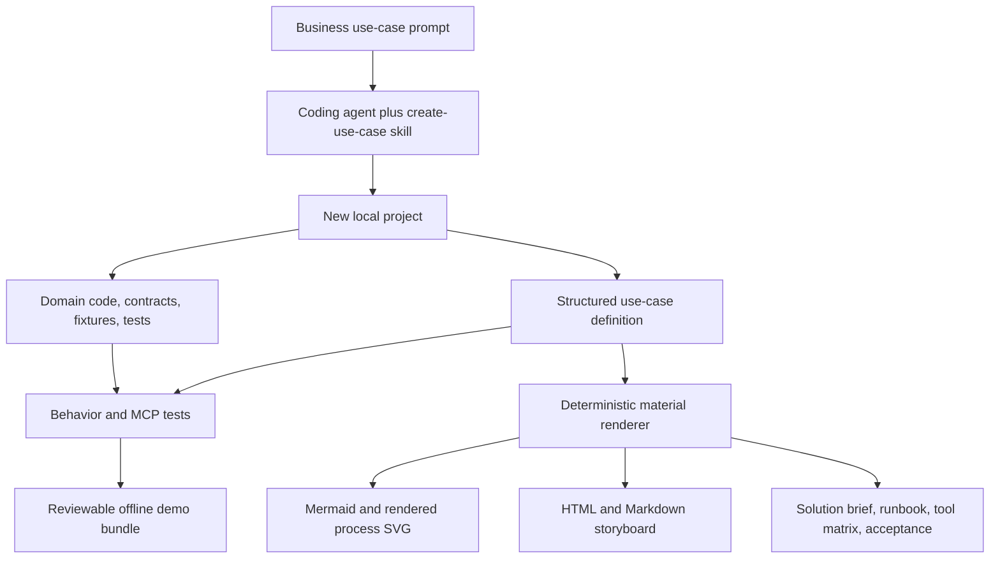

# Architecture

The user's business prompt drives both the implementation and its demo materials. A coding agent interprets the prompt; deterministic scripts copy portable source and render the agent-authored structured definition. There is no hidden LLM call inside the generator or renderer.

The business process for the included use case is rendered separately at [process.svg](generated/process.svg), with [Mermaid source](generated/process.mmd).

## Execution boundary

Coding-agent skills describe creation, connection, rehearsal, and verification. The local MCP server exposes the registry's five fixture tools through the official SDK. Runtime handlers validate tool inputs and outputs and enforce record versions, folder scope, allowed proposal fields, and output readiness. All local operations are read-only; proposals and approval checks cannot apply changes.

For a live extension, Box owns governed content and the chosen record system owns structured facts. A provider adapter must establish identity and authorization server-side. Cloud orchestration, analytics, Salesforce UI, and a portal can be added when the use case requires them; none is silently implied by the starter.

## Narrative and code consistency

`config/use-case.json` holds the original request, actors, authorities, steps, prompts, evidence expectations, failure responses, and acceptance criteria. Its schema and registered tool references are validated before rendering. Code and fixtures still need semantic review: a schema cannot prove a supplier workflow stopped using loan logic. The creation skill and acceptance checklist require this review.

Generated assets are committed alongside their source, and validation compares their contents deterministically. The SVG is a dependency-free process rendering from the same step list as the Mermaid source; long labels are summarized visually while full text remains in the storyboard.
